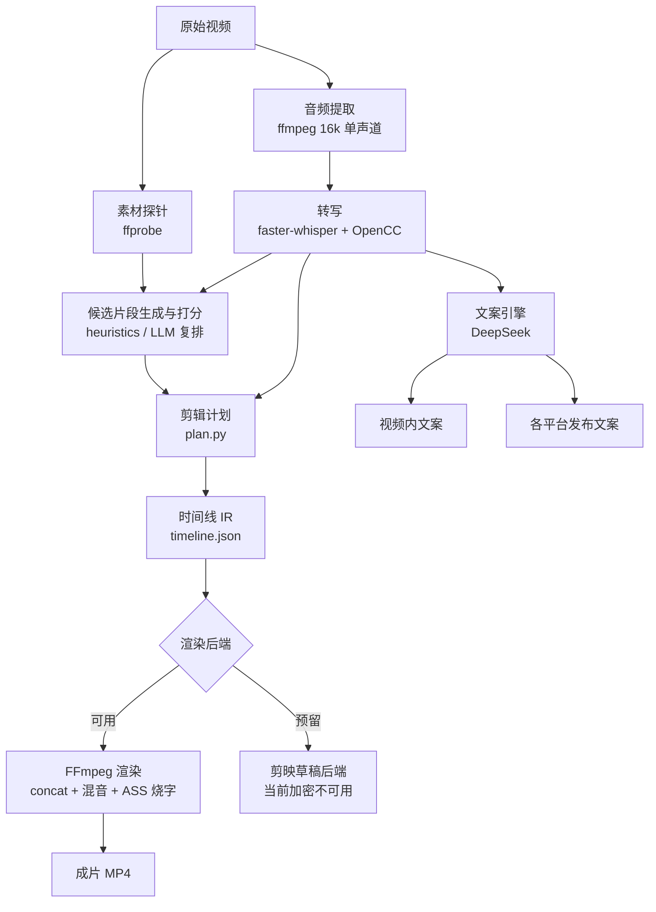

# AI 自动剪辑项目书

> 版本 0.1.0 · 最后更新 2026-10-22
> 本文档描述项目现状、设计取舍、验证结果与后续规划。

---

## 一、项目概述

### 1.1 目标

构建一条**本地可运行**的 AI 辅助剪辑流水线：输入一段原始视频，自动完成转写、高光选段、字幕生成、成片渲染，并产出可直接用于发布的文案。

### 1.2 核心价值

把视频生产中**机械劳动**交给程序，人只保留三个决策：讲什么、选哪段、起什么标题。

### 1.3 明确的目标边界

| 是 | 不是 |
|---|---|
| 单机本地运行，素材不出本机 | 不做云端托管服务 |
| 自动粗剪 + 文案生成 | 不做精细包装（转场、花字、贴纸、特效） |
| 成片直接输出 MP4 | 不在当前版本内操作剪映界面 |
| 面向口播/教程/访谈类有人声素材 | 不擅长纯音乐、纯画面、监控类素材 |

### 1.4 关键设计约束

1. **草稿加密是硬约束。** 本机剪映专业版 7.1.0.12416 的 `draft_content.json` 与 `draft_meta_info.json` 均为加密内容（Base64 密文，解码后无 JSON 结构）。因此不能采用"生成剪映草稿"作为主路径，改用 FFmpeg 直接渲染成片。
2. **执行层必须可插拔。** 内容理解与时间线决策与剪映无关，代码需 100% 复用，未来换后端不改上层。
3. **文案必须区分场景。** 画面里出现的文字与平台表单里填写的文字是两种东西，混在一起会导致成片字幕像标题，标题又像字幕。

---

## 二、总体架构



### 2.1 分层职责

| 层 | 模块 | 职责 | 是否依赖剪映 |
|---|---|---|---|
| 表示层 | `ir.py` | 定义时间线中间表示与校验 | 否 |
| 理解层 | `analysis/*` | 探针、转写、候选片段打分 | 否 |
| 决策层 | `plan.py` | 把选段转成可渲染时间线 | 否 |
| 文案层 | `copywriter/*` | 视频内文案 + 各平台发布文案 | 否 |
| 渲染层 | `render.py`, `subtitle.py` | FFmpeg 命令构造与字幕生成 | 否 |
| 适配层 | `adapters/*` | 后端协议与实现 | 仅此层关心 |

### 2.2 为什么中间表示（IR）是核心

所有上游只产出 IR，所有下游只消费 IR。带来三个直接好处：

- 换渲染后端（FFmpeg → 剪映明文稿 → 达芬奇）不改决策逻辑；
- 时间线可人工编辑后再渲染，便于精修；
- 渲染结果可复现：IR 即"剪辑源码"。

---

## 三、模块说明

### 3.1 时间线 IR（`ir.py`，230 行）

```json
{
  "canvas": { "w": 1080, "h": 1920, "fps": 30 },
  "tracks": {
    "video": [{ "src": "a.mp4", "in": 12.4, "out": 16.0, "muted": false, "volume": 1.0 }],
    "audio": [{ "src": "bgm.m4a", "out": 7.2, "volume": 0.15, "loop": true }],
    "text":  [{ "text": "别再一帧一帧剪了", "start": 0, "end": 1.6, "style": "hook" }]
  }
}
```

设计要点：

- 时间单位统一为秒（float），避免剪映微秒单位渗透到上层；
- 相对路径按 IR 文件所在目录解析，整包可移动；
- 构造即校验：时长倒挂、空时间线、非法画布直接抛 `IRValidationError`。

### 3.2 素材理解（`analysis/`，695 行）

| 文件 | 职责 | 关键实现 |
|---|---|---|
| `media.py` | ffprobe 封装 | 时长、分辨率、是否有音视频轨 |
| `asr.py` | 转写 | ffmpeg 解码为 float32 波形 → faster-whisper → OpenCC 转简体 |
| `transcript.py` | 转写数据模型 | SRT/VTT 解析、切片、导出、纯文本估算时间轴 |
| `highlights.py` | 选段 | 滑窗生成候选 + 五维打分 + 去重叠 + 无人声兜底 |

**选段打分模型**（总分 100）：

| 维度 | 上限 | 依据 |
|---|---|---|
| 钩子 | 30 | 高唤醒词、疑问句、数字、强断言出现在开头 30 字 |
| 密度 | 20 | 汉字/秒落在 3.0–7.5 舒适区给满分 |
| 完整性 | 15 | 句末有句号或收束词 |
| 时长 | 20 | 与目标时长偏差越小越高 |
| 位置 | 15 | 略偏好前段（通常是抛钩子的位置） |

### 3.3 剪辑计划（`plan.py`，176 行）

把"选中片段 + 转写"映射为 IR：

- 视频轨按片段顺序裁切；
- 字幕按候选起点平移，长句按标点或字数二次切分（默认 24 字/条）；
- 自动钩子与首句字幕内容重复时只保留钩子，避免同一句话叠两层；
- BGM 按成片总时长循环并压低音量。

### 3.4 渲染内核（`render.py`，205 行）

单条 ffmpeg 命令完成全部工作，避免中间文件与多代编码：

1. 每个视频片段独立 `-ss` 定位，只解码需要的区间；
2. 统一 `scale + pad + setsar + fps` 后 `concat`；
3. 静音片段用 `anullsrc` 补轨，保证 concat 的音频流连续；
4. 叠加音频轨用 `adelay` 对齐起点、`amix` 混入，**`normalize=0`** 防止 amix 自动衰减音量；
5. 字幕走 ASS 烧制，中文样式与分辨率自适应。

### 3.5 文案引擎（`copywriter/`，565 行）

**两类文案的职责切分：**

| 类别 | 字段 | 使用位置 |
|---|---|---|
| 视频内文案 | `hook`（≤18 字）、`cover_text`（≤8 字）、`oral_script`、`chapters` | 画面字幕、封面、配音 |
| 发布文案 | 每个平台一套 `title` / `body` / `hashtags` | 平台发布表单 |

**平台规格表**（`platforms.py`）：

| 平台 | 标题上限 | 正文上限 | 标签上限 | 风格定位 |
|---|---|---|---|---|
| 抖音 | 30 | 120 | 5 | 口语、直接，前 12 字即钩子 |
| 小红书 | 20 | 800 | 10 | 分享口吻，分段短句，可用 emoji |
| 视频号 | 16 | 1000 | 3 | 正式朴实，面向熟人社交 |
| B站 | 80 | 1000 | 10 | 信息量大，可分点配章节 |
| 快手 | 30 | 200 | 5 | 接地气，强调实用经验 |

超限自动截断并写入备注，避免用户复制后被平台拒绝。

**多候选 + 自评分：**

- 每次生成指定不同切入角度（8 种：数据反差、提问开场、痛点直击、反常识、结果先行、身份代入、时间成本、对比框架）；
- 已生成的钩子与标题回传给下一轮，显式禁止重复；
- 独立 critic 调用按五维打分（hook / emotion / clarity / platform / finish，各 20 分），按总分降序返回。

### 3.6 出片后端（`adapters/`，181 行）

| 后端 | 状态 | 说明 |
|---|---|---|
| `ffmpeg_backend` | 可用 | 当前唯一开箱可用的出片路径 |
| `jianying_backend` | 不可用（自动降级） | 自动定位草稿根目录并检测加密状态，明确报错而非静默失败 |

`jianying_backend` 保留了完整接口：一旦升级到剪映 11.5+ 并接入 `jy-draftc`（调用 `videoeditor.dll` 完成加解密与无头导出），只需实现 `render()`，上层零改动。

### 3.7 交互层（`cli.py` 524 行 / `webui.py` 318 行）

- CLI：10 个子命令，适合脚本化与批处理；
- Web：Streamlit 单页，适合上传素材即时预览。

---

## 四、使用说明

### 4.1 环境要求

| 依赖 | 已验证版本 | 说明 |
|---|---|---|
| Python | 3.12.10 | 需 3.10+ |
| FFmpeg | 9.0.2 | 必须含 libass、drawtext |
| faster-whisper | 1.2.1 | CPU 可跑，无需 torch |
| streamlit | 1.66.1 | 仅网页界面需要 |
| DeepSeek API | `deepseek-flash` | 文案生成，OpenAI 兼容协议 |

### 4.2 安装

```powershell
cd D:\AI-Cut
python -m pip install -e .
python -m pip install faster-whisper streamlit opencc-python-reimplemented
copy .env.example .env    # 填入 AICUT_LLM_API_KEY
```

### 4.3 密钥管理

密钥只放在 `.env`，已被 `.gitignore` 排除。三条约束：

1. 源码不含任何密钥常量；
2. `aicut config` 只输出掩码（`sk-...675a`）；
3. 报错信息只保留服务端返回内容，不回显请求头。

### 4.4 命令参考

| 命令 | 用途 |
|---|---|
| `aicut web` | 启动网页界面（默认 http://localhost:8501） |
| `aicut probe <media>` | 查看素材信息 |
| `aicut transcribe <media>` | 转写并导出 JSON/SRT |
| `aicut select <transcript>` | 只做候选片段打分 |
| `aicut autoplan <media>` | 转写 + 选段 + 时间线 +（可选）渲染 +（可选）文案 |
| `aicut render <timeline>` | 按时间线渲染 |
| `aicut copy <text>` | 生成文案（支持 `-n` 多候选） |
| `aicut backend` | 查看出片后端可用性 |
| `aicut config` | 查看 LLM 配置（掩码） |
| `aicut demo` | 无外部素材的自检 |

常用组合：

```powershell
# 一条命令出片 + 文案
aicut autoplan video.mp4 --target 30 --render out/clip.mp4 `
  --copy --copy-candidates 3 --platforms "抖音,小红书,视频号,B站" --topic "剪辑效率"

# 只看选段打分
aicut select transcript.json --target 30 --top 3

# 纯文案
aicut copy 转写文本.txt --platforms "抖音,小红书" -n 5 --out copy.json
```

---

## 五、验证记录

### 5.1 自动化测试

```
68 passed in 0.95s
```

| 测试文件 | 用例数 | 覆盖内容 |
|---|---|---|
| `test_ir.py` | 8 | 路径解析、时长兜底、非法 IR 拒绝、序列化往返 |
| `test_transcript.py` | 6 | 时间戳格式、SRT 往返、切片、纯文本估算、按扩展名分派 |
| `test_highlights.py` | 9 | 打分区分度、候选时长边界、去重叠、无人声兜底 |
| `test_plan.py` | 9 | 字幕平移、钩子去重、长句切分、BGM 循环、多片段偏移 |
| `test_subtitle.py` | 3 | SRT 编码、ASS 样式映射、换行转义 |
| `test_render.py` | 2 | 滤镜图结构、端到端真实渲染并校验输出 |
| `test_asr.py` | 4 | 波形解码、缺文件报错、繁简转换与降级 |
| `test_config.py` | 7 | .env 优先级、掩码、缺密钥报错 |
| `test_copywriter.py` | 20 | 多平台解析、截断、标签规范化、评分排序、部分失败容错 |

### 5.2 端到端实测

| 场景 | 输入 | 结果 |
|---|---|---|
| 合成素材自检 | ffmpeg 生成的测试图 + 正弦音 | 5.5s 成片，双轨拼接、静音段补轨、BGM 混音、双语字幕全部正确 |
| 真实口播（TTS） | 35s 中文语音 + 画面 | 自动选出 19s 片段（得分 97.8），字幕准确，文案最高 90/100 |
| 监控素材（无人声） | 75.3s 夜间监控 | 明确提示无人声 → 均分取材 → 30s 成片成功，不再卡死 |
| 多平台文案 | 同一段转写 | 四平台标题长度分别为 27/15/10/37 字，风格差异明显 |
| 网页全流程 | 上传 → 5 步 → 预览 → 下载 | 50.9 秒完成，含 3 条候选 × 4 平台文案 |

### 5.3 踩坑与修复记录

| 问题 | 根因 | 处理 |
|---|---|---|
| `TypeError: metadata_errors` | faster-whisper 依赖的 PyAV 19 移除了该参数 | 改用 ffmpeg 解码为 float32 波形再喂模型 |
| 中文输出繁体 | Whisper 在 `language=zh` 下可能输出繁体 | `initial_prompt` 引导 + OpenCC `t2s` 兜底 |
| 短文识别错字 | `small` 模型中文准确率不足 | 默认模型改为 `medium`（"你剪视频慢" 正确识别） |
| 声音忽大忽小 | `amix` 默认按输入数量衰减 | 加 `normalize=0`，音量完全由片段 `volume` 决定 |
| 界面卡住转圈 | 错误在 `st.status` 块内 `st.stop()`，状态停在 running | 先置 `state="error"` 再退出，并补无人声兜底 |
| 横屏被压出黑边 | 强制竖屏画布 | 新增「跟随素材」画布，按源分辨率渲染 |
| API 连接被拒 | 系统代理 `127.0.0.1:7890` 未启动 | 代理失败自动改直连重试一次 |
| 文件编码被写坏 | 用 PowerShell 重写含中文的 Python 文件 | 改为工具直接写入，并加入全仓库编码自检 |

---

## 六、已知限制

### 6.1 功能限制

| 限制 | 影响 | 缓解方式 |
|---|---|---|
| 只支持有人声素材 | 纯音乐/监控类无法语义选段 | 已实现均分兜底，可出片但无字幕文案 |
| 画面处理较基础 | 仅等比缩放 + 填充 + 字幕，无转场/花字/贴纸 | 需要精修时在剪映人工完成 |
| 单视频源 | 一条成片只能取自同一个文件 | 后续支持多素材混剪 |
| 静态裁切 | 无主体跟踪，横屏转竖屏会留边 | 优先用「跟随素材」画布 |
| 选段为启发式 | 靠关键词与句长，非语义理解 | 可开 `--llm-rank` 用模型复排 |

### 6.2 技术限制

| 限制 | 说明 |
|---|---|
| 剪映草稿加密 | 7.1 版本不可写；升级 11.5+ 并接 `jy-draftc` 后可启用后端 |
| 转写耗时 | medium 模型在 CPU 上约为音频时长的 1–2 倍 |
| 网页上传上限 | Streamlit 默认 200MB |
| 文案依赖外部 API | 离线环境不可用，需自备 OpenAI 兼容服务 |

### 6.3 风险与对策

| 风险 | 等级 | 对策 |
|---|---|---|
| 剪映版本更新导致后端彻底失效 | 中 | 后端已隔离，主路径不依赖剪映 |
| 平台文案规则变化 | 低 | 规格集中在 `platforms.py`，改一处即可 |
| 模型接口涨价或下线 | 中 | 走 OpenAI 兼容协议，可切换任意供应商 |
| 素材版权与 AI 生成标注合规 | 高 | 需使用方自行登记素材来源并按平台要求标注 |

---

## 七、目录结构

```
D:\AI-Cut
├─ src/aicut/
│  ├─ ir.py                 # 时间线中间表示
│  ├─ plan.py               # 剪辑计划（选段 → 时间线）
│  ├─ render.py             # FFmpeg 渲染内核
│  ├─ subtitle.py           # SRT / ASS 生成
│  ├─ config.py             # LLM 配置与密钥解析
│  ├─ cli.py                # 命令行入口
│  ├─ webui.py              # Streamlit 网页界面
│  ├─ demo.py               # 自检素材生成
│  ├─ adapters/             # 出片后端（ffmpeg / 剪映）
│  ├─ analysis/             # 探针、ASR、转写、选段
│  └─ copywriter/           # 文案引擎与平台规格
├─ tests/                   # 68 个测试
├─ out/                     # 渲染产物（不入库）
├─ vendor/                  # 参考仓库（不入库）
├─ .env.example             # 密钥模板
└─ pyproject.toml
```

代码规模：源码约 3,180 行，测试约 840 行。

---

## 八、后续规划

### 8.1 优先级排序

| 优先级 | 事项 | 价值 | 预估 |
|---|---|---|---|
| 高 | 智能裁切（主体跟踪转竖屏） | 解决横屏素材留边的核心痛点 | 3–5 天 |
| 高 | 文案钩子回写视频开场字 | 当前钩子取自转写，非最优表达 | 0.5 天 |
| 中 | 多素材混剪 | 一条成片串多个高光片段 | 2–3 天 |
| 中 | 转场与卡点 | 按语音停顿自动加转场 | 2 天 |
| 中 | 批量处理 | 目录级批跑，适合日更 | 1 天 |
| 低 | 剪映后端接入 | 可在剪映内二次精修 | 视剪映版本 |
| 低 | 发布数据回流 | 用实际表现反哺选段与文案评分 | 2 天 |

### 8.2 判断依据

先做"智能裁切"与"钩子回写"，因为这两项直接决定成片观感；纯音乐素材支持与批量处理属于覆盖面扩展，应在核心质量达标后再做。

---

## 九、开发指南

### 9.1 运行测试

```powershell
python -m pytest -q
python -m pytest tests/test_render.py -v      # 单文件
```

### 9.2 代码约定

- 时间统一用秒（float），不使用帧或微秒；
- 上游模块只产出 IR，不直接调用渲染；
- 重量级依赖（faster-whisper、opencc）按需导入，缺失时给出可执行提示；
- 外部调用失败不得阻断成片，文案与评分均为增强项。

### 9.3 调试技巧

```powershell
aicut render timeline.json -o out.mp4 --dry-run   # 只打印 ffmpeg 命令
aicut backend                                     # 确认后端可用性
aicut config                                      # 确认密钥与模型
```

---

## 十、变更记录

| 提交 | 内容 |
|---|---|
| 初始提交 | IR、FFmpeg 渲染、选段、文案骨架 |
| 接入 ASR | faster-whisper，绕开 PyAV 不兼容，OpenCC 统一简体 |
| 配置层 | `.env` 隔离密钥、掩码显示、`autoplan` 一键出片带文案 |
| 多候选文案 | flash 模型、角度去重、五维打分、标签规范化 |
| 网页界面 | Streamlit 上传、预览、下载、文案展示 |
| 修复卡死 | 无人声兜底、状态收尾、画布跟随素材、VAD 可关 |
| 文案拆分 | 视频内文案与各平台发布文案分离，按平台规格生成并裁剪 |

---

*本文档随代码同步维护。修改功能或新增平台时，请一并更新第三章与第五章。*
